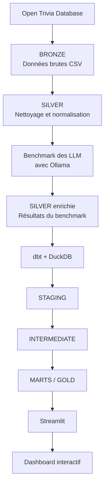

# 🎯 Trivial Pursuit — Benchmark de modèles d'IA

**Projet collaboratif réalisé dans le cadre du M1 Data Engineering & Intelligence Artificielle à EFREI.**

Ce projet consiste à comparer les performances de modèles de langage (*Large Language Models — LLM*) exécutés localement, à partir de questions de culture générale. Il met en œuvre un pipeline Data Engineering permettant de collecter, nettoyer, enrichir, transformer et analyser les données.

L'objectif est d'évaluer les modèles selon plusieurs critères : **précision des réponses, rapidité d'exécution et régularité des temps de réponse**.

## 📌 Sommaire

* [Objectifs](#-objectifs)
* [Questions métier](#-questions-métier)
* [Dataset](#-dataset)
* [Architecture Data Engineering](#-architecture-data-engineering)
* [Modèles d'IA](#-modèles-dia)
* [Métriques d'évaluation](#-métriques-dévaluation)
* [Technologies](#-technologies)
* [Structure du projet](#-structure-du-projet)
* [Installation](#-installation)
* [Exécution](#-exécution)
* [Perspectives](#-perspectives)
* [Auteurs](#-auteurs)

## 🎯 Objectifs

Le projet vise à :

* Récupérer et nettoyer des questions issues de l'Open Trivia Database.
* Évaluer plusieurs modèles de langage exécutés localement.
* Mesurer la précision et les temps de réponse des modèles.
* Comparer les performances selon la catégorie et la difficulté des questions.
* Mettre en place une architecture de données de type **Medallion : Bronze, Silver et Gold**.
* Utiliser dbt pour transformer et modéliser les données analytiques.
* Exploiter DuckDB pour les analyses.
* Développer un tableau de bord interactif avec Streamlit.

## ❓ Questions métier

Le benchmark cherche à répondre aux questions suivantes :

1. Quel modèle obtient la meilleure précision ?
2. Quel modèle répond le plus rapidement ?
3. Comment la précision évolue-t-elle selon la difficulté des questions ?
4. Quelles catégories favorisent ou pénalisent les performances des modèles ?
5. Quel modèle présente les temps de réponse les plus réguliers ?

## 📊 Dataset

Les questions proviennent de [Open Trivia Database](https://opentdb.com/).

Après nettoyage et déduplication, le dataset utilisé pour le benchmark contient **5 295 questions**, selon les informations du projet.

Les principales données exploitées sont :

* La catégorie de la question.
* Le niveau de difficulté.
* L'énoncé de la question.
* La réponse correcte.
* Les réponses incorrectes.

Les données sont ensuite préparées pour l'évaluation des modèles et l'analyse des résultats.

## 🏗️ Architecture Data Engineering

Le projet suit une architecture Medallion organisée en trois couches : Bronze, Silver et Gold.



### 1. Bronze — Données brutes

La couche Bronze conserve les données collectées depuis Open Trivia Database.

Fichier principal mentionné dans le projet :

`data/bronze/questions_raw.csv`

Cette couche sert de point de départ aux traitements et permet de conserver les données originales.

### 2. Silver — Données nettoyées et enrichies

La couche Silver contient les données nettoyées et normalisées, notamment au format Parquet.

Fichier de questions nettoyées :

`data/silver/questions_clean.parquet`

Après l'évaluation des modèles, cette couche contient également les résultats enrichis du benchmark, notamment pour :

* Gemma 3 4B.
* LLaMA 3.2 3B.

Ces données permettent de relier les questions aux réponses produites par les modèles et aux mesures de performance collectées.

### 3. Gold — Données analytiques

La couche Gold est construite à l'aide de **dbt et DuckDB**. Elle organise les données afin de faciliter les analyses métier.

Les transformations dbt sont réparties en trois niveaux :

**Staging**

Les modèles `stg_gemma` et `stg_llama` préparent les données issues des résultats du benchmark.

**Intermediate**

Le modèle `int_model_results` regroupe les résultats des modèles dans une structure commune pour faciliter les comparaisons.

**Marts**

Les modèles analytiques répondent aux principales questions métier :

| Modèle                     | Objectif                               |
| -------------------------- | -------------------------------------- |
| `mart_model_comparison`    | Comparaison globale des modèles        |
| `mart_accuracy_category`   | Analyse de la précision par catégorie  |
| `mart_accuracy_difficulty` | Analyse de la précision par difficulté |
| `mart_response_time`       | Analyse des temps de réponse           |

## 🤖 Modèles d'IA évalués

Les modèles sont exécutés localement à l'aide d'[Ollama](https://ollama.com/).

* **Gemma 3 4B**
* **LLaMA 3.2 3B**

Pour chaque évaluation, le projet prévoit notamment de conserver des informations sur le modèle utilisé, la réponse produite, le temps de réponse et la correction de la réponse.

La réponse brute et le prompt peuvent également être conservés pour faciliter l'analyse des résultats.

## 📈 Métriques d'évaluation

Le benchmark s'appuie sur plusieurs indicateurs complémentaires.

| Métrique          | Signification                                                          |
| ----------------- | ---------------------------------------------------------------------- |
| Accuracy          | Pourcentage de réponses correctes                                      |
| Temps moyen       | Temps moyen nécessaire pour répondre                                   |
| Médiane           | Temps de réponse central, moins sensible aux valeurs extrêmes          |
| Minimum / Maximum | Plus petit et plus grand temps observé                                 |
| Écart-type        | Dispersion des temps de réponse, utilisée pour étudier leur régularité |

L'objectif n'est pas seulement d'identifier le modèle le plus précis, mais aussi d'étudier le compromis entre **précision, rapidité et stabilité**.

## 🛠️ Technologies

| Technologie   | Utilisation                                |
| ------------- | ------------------------------------------ |
| Python        | Traitement et automatisation               |
| Pandas        | Manipulation des données                   |
| PyArrow       | Lecture et écriture des fichiers Parquet   |
| Ollama        | Exécution locale des modèles de langage    |
| dbt           | Transformation et modélisation des données |
| DuckDB        | Stockage analytique et requêtes SQL        |
| Streamlit     | Développement du dashboard interactif      |
| Plotly        | Visualisation des données                  |
| Git et GitHub | Versionnement et collaboration             |

## 📁 Structure du projet

Les principaux répertoires du dépôt sont organisés comme suit :

```text
Trivial-Pursuit-M1-DE/
├── data/
│   ├── bronze/
│   └── silver/
├── dbt/
│   └── models/
├── notebooks/
├── src/
├── streamlit/
├── tests/
├── dbt_project.yml
├── requirements.txt
├── README.md
└── .gitignore
```

Cette représentation indique les principaux dossiers du projet. Les fichiers et sous-dossiers exacts peuvent varier selon la version du dépôt.

## ⚙️ Installation

### Prérequis

Avant de commencer, installer :

* Python.
* Git.
* Ollama.
* Les modèles Ollama utilisés pour le benchmark.

### 1. Cloner le dépôt

```bash
git clone https://github.com/allanbrows/Trivial-Pursuit-M1-DE.git
cd Trivial-Pursuit-M1-DE
```

### 2. Créer un environnement virtuel

```powershell
python -m venv .venv
```

Sous Windows PowerShell, activer l'environnement :

```powershell
.\.venv\Scripts\Activate.ps1
```

### 3. Installer les dépendances Python

```bash
python -m pip install --upgrade pip
pip install -r requirements.txt
```

### 4. Télécharger les modèles Ollama

```bash
ollama pull gemma3:4b
ollama pull llama3.2:3b
```

Vérifier que les modèles sont disponibles :

```bash
ollama list
```

## ▶️ Exécution

### 1. Vérifier la configuration dbt

Depuis le répertoire du projet, exécuter :

```bash
dbt debug --profile trivial_pursuit
```

Cette commande vérifie la configuration dbt et la connexion à la base de données.

### 2. Exécuter les transformations

```bash
dbt run --profile trivial_pursuit
```

Cette commande exécute les modèles dbt configurés pour le projet.

### 3. Lancer le dashboard

```bash
streamlit run streamlit/app.py
```

Le dashboard permet de visualiser et de comparer les performances des modèles, sous réserve que les données du benchmark et les transformations nécessaires aient été générées.

> **Remarque :** les commandes dbt et le chemin du dashboard doivent correspondre à la configuration réellement présente dans le dépôt. Si le profil dbt ou les fichiers de configuration diffèrent, il faudra adapter ces commandes.

## 🚀 Perspectives d'amélioration

Plusieurs évolutions sont envisageables :

* Évaluer davantage de modèles de langage.
* Comparer différentes formulations de prompts.
* Étudier l'influence de la longueur des réponses.
* Approfondir l'analyse de robustesse.
* Ajouter de nouvelles visualisations au dashboard.
* Renforcer les tests automatisés des modèles dbt.

## 👥 Auteurs

Projet collaboratif réalisé dans le cadre du **M1 Data Engineering & Intelligence Artificielle à EFREI**.

* **Allan Miguel Domguia**
* **Soufiane Lemsouri**

Projet GitHub : [Trivial-Pursuit-M1-DE](https://github.com/allanbrows/Trivial-Pursuit-M1-DE)
